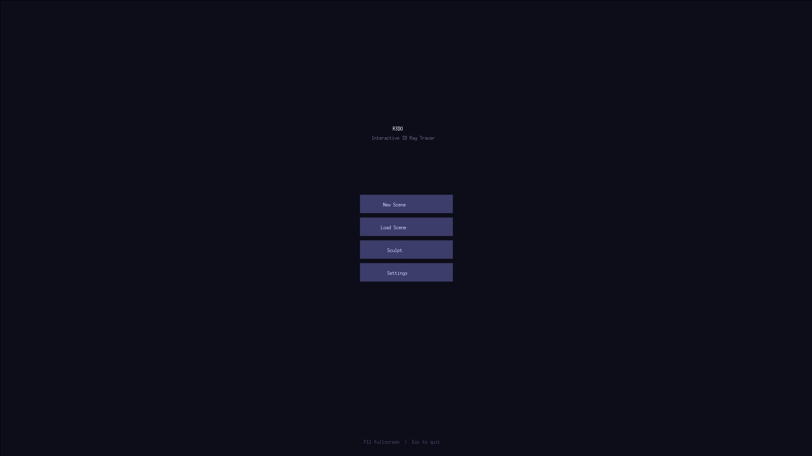
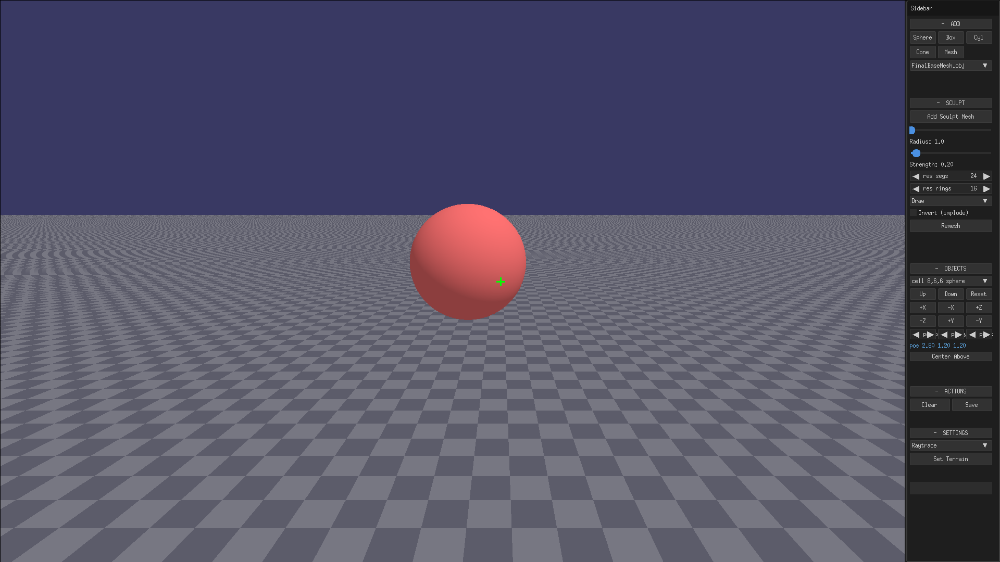
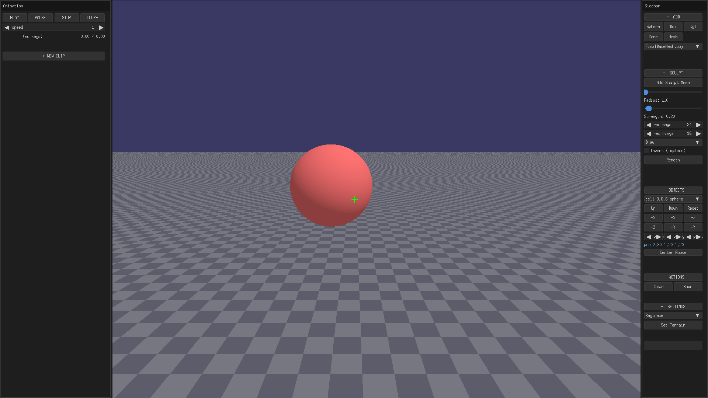
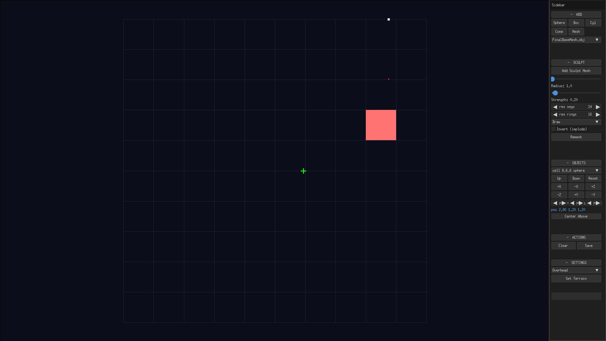
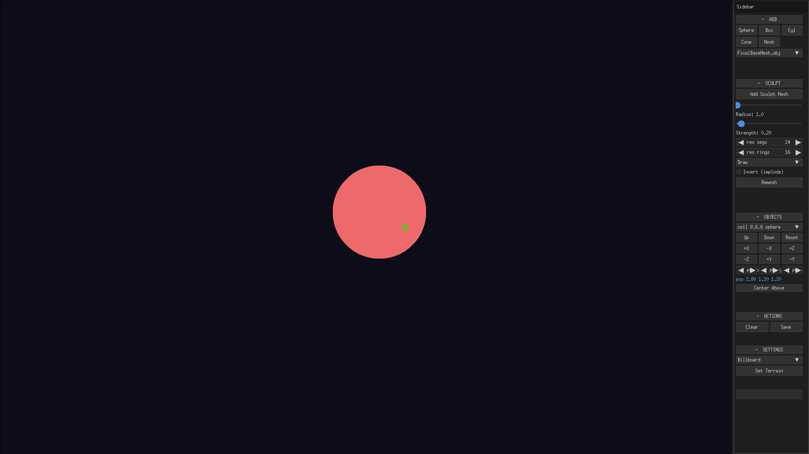

# R3DO — Interactive 3D Ray Tracer

A real-time CPU ray tracer rendered into an X11 window. Build scenes in a 10×10×10
voxel grid (spheres, boxes, cylinders, cones, meshes, sculptable terrain), animate
them with keyframes or procedural modifiers, and drag objects directly in the viewport.



## Features

- **Ray traced scene view** — DDA voxel traversal keeps ray casts fast; directional
  diffuse lighting with gamma-corrected output.
- **Mouse drag gizmo** — press left-click on any object to grab it: it follows the
  mouse on the camera-facing plane, cell objects magnetize to the nearest free cell,
  and objects dragged outside the grid automatically become free objects (and
  re-home when dragged back). Empty-space drags still rotate the camera.
- **Shared position** — drag, move buttons and the sidebar `pos x/y/z` editor all
  move the same live base. The animation system reads that base every frame, so any
  edit changes where an animation plays from without breaking your keys.
- **Animation system** — keyframe clips per target with Position / Rotation / Scale /
  Color tracks, linear and eased interpolation, per-clip looping, a scrub timeline,
  and procedural modifiers (**Sine Bob**, **Spin**, **Noise Shake**) you can stack on
  top of keys. Targets can be free objects, grid cells, or the **camera** itself.



- **Animation panel** — press `T` to open. Play / pause / stop / loop, playback
  speed, timeline scrub (previews the pose while paused), key capture straight from
  the live scene, per-track listing, and the target picker with a camera entry and
  cell-target mode.



- **Render modes** (cycle with `B` or the sidebar combo):
  - **Raytrace** — full path through the grid; all animation properties apply.
  - **Billboard** — fast 2D sprite projection (circle / diamond / triangle per shape).
  - **Overhead** — top-down map of the grid with free-object markers.




- **Sculpt mode** — brush-based mesh sculpting (Draw / Inflate / Smooth-style
  brushes, invert, radius & strength sliders, remesh, terrain load), with its own
  undo stack.

## Controls

| Key | Action |
|-----|--------|
| W/S | Move forward/backward |
| A/D | Strafe left/right |
| Q/E | Move up/down |
| ← → ↑ ↓ | Look around |
| B | Cycle render mode (Raytrace → Billboard → Overhead → Sculpt → Static) |
| T | Toggle the animation panel |
| G | Toggle ground mode |
| Space | Full-quality re-render |
| Ctrl+Z / Ctrl+Y | Undo / redo scene (sculpt mode has its own) |
| Esc | Quit — while dragging an object: cancel the drag |
| F11 | Toggle windowed mode |
| **Left click on object** | Grab and drag it (gizmo) |
| **Shift + drag** | Vertical-only movement |
| **Left drag on empty space** | Look around (mouse look) |
| **Left click empty space** | Delete the object under the center crosshair |
| **Right click** | Quick-place the last used shape |
| **Right drag (sculpt mode)** | Sculpt stroke (inverts the brush) |
| Alt+Shift | Toggle mouse capture |

The program starts at the resolution saved in `settings.cfg` (or 1920×1080 by
default). Use the **Settings** button on the start screen to change it.

## Start Screen

On launch you get **New Scene**, **Load Scene**, **Sculpt** (jumps straight into
sculpt mode) and **Settings**. **Load Scene** lists all `.r3do` files found in
`saves/`; the default autosave is not loaded automatically.

## Save System

All scene changes are automatically saved to `saves/default.r3do`. To snapshot a
scene, click **Save** name the file; loads are picked from the start screen.
Scene files store objects, transforms, and animation clips.

## Animation Workflow

1. Press `T`, then `+ NEW CLIP`.
2. Pick a target in the combo: a free object, `cell i,j,k` (enable the cell
   checkbox), or `camera`.
3. Set the key time with the slider, adjust key x/y/z (or press **SYNC FROM TGT**
   / **KEY @ TGT** to capture the target's live pose), then `+ KEY`.
4. `PLAY` to watch; pause and scrub the timeline to preview any time.
5. Stack procedural modifiers (`+ SINE / + SPIN / + SHAKE`) for continuous motion.

Because keys are stored as offsets from the object's *live* base position, you can
keep moving the object with the drag gizmo or the position editor at any time — the
whole animation travels with it. The world position is shown in both the sidebar
(`pos` fields) and the animation panel (`world pos:` readout).

## Build

Requires libx11-dev.

```sh
make -j4
./R3DO
```

## How it works

- **DDA traversal** (`grid.hpp`): rays step cell-by-cell along the voxel grid using
  a 3D Digital Differential Analyzer with 4×4×4 chunk skip flags; free objects are
  always tested first so off-grid placement still renders.
- **Primitives**: spheres, axis-aligned boxes, capped cylinders/cones, triangle
  meshes with a SAH BVH, and sculptable meshes (flat BVH kept in sync on moves).
- **Animation** (`animation.hpp/cpp`): clips hold typed tracks with per-key
  interpolation; `ClipInstance` binds a clip to a free object, cell or camera and
  stacks procedural modifiers; playback speed and loop semantics are per clip.
- **Transforms** (`hittable.hpp`): per-object animated offset + Euler rotation +
  scale + color tint applied in every shape's `hit()` with an identity fast path.
- **UI**: Nuklear drawn into the same X11 framebuffer (`ui/` — core event hook,
  sidebar, animation panel, start screens).
- **Multi-sampling**: low quality (1 sample/px) during movement; full quality
  (4 samples/px) on Space per `settings.cfg`.

## Files

| File | Role |
|------|------|
| `main.cpp` | Entry point, game loop, drag gizmo wiring, animator application |
| `animation.hpp` / `animation.cpp` | Clips, keyframes, interpolation, modifiers |
| `ui/nkui.hpp` / `ui/nkui_core.cpp` | Nuklear setup, event hook, frame compositing |
| `ui/nkui_sidebar.cpp` | Sidebar (add, sculpt, objects, actions, settings) |
| `ui/nkui_anim.cpp` | Animation panel (playback, keys, targets, modifiers) |
| `ui/startscreen.cpp` | Start / load / settings screens |
| `ui.hpp` / `ui.cpp` | Scene state, move/select, drag gizmo, save dialog |
| `render.hpp` / `render.cpp` | Ray tracing, picking (`pick_at_mouse`) |
| `grid.hpp` | Voxel grid with DDA traversal, cell management, terrain |
| `hittable.hpp` | Hittable base incl. animated transforms |
| `sphere.hpp` `box.hpp` `cylinder.hpp` `cone.hpp` | Primitives |
| `mesh.cpp` / `mesh.hpp` | OBJ meshes with SAH BVH |
| `sculpt_mesh.cpp` / `sculpt_engine.cpp` | Sculptable meshes and brush engine |
| `saver.hpp` / `saver.cpp` | Scene save/load `.r3do` |
| `display.hpp` / `display.cpp` | X11 window, input, MIT-SHM framebuffer |
| `settings.hpp` / `settings.cpp` | Resolution settings persistence |

## Known limitations

- Billboard and Overhead previews show position animation only — rotation, scale
  and color tint apply in Raytrace mode.
- Cell-bound objects animate within the grid hull; poses pushed outside the grid
  hull are invisible in raytrace mode (free objects have no such limit).
