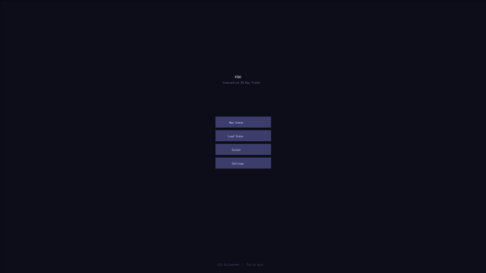
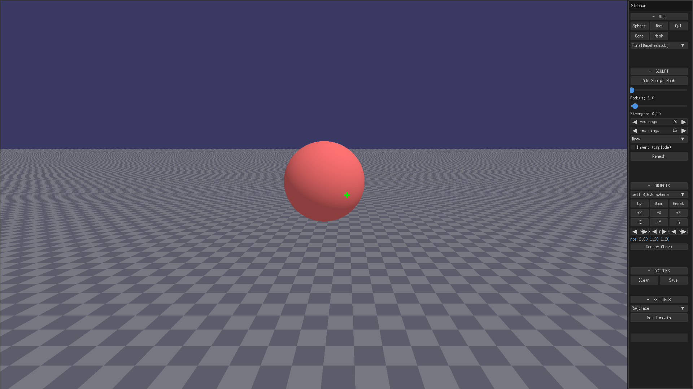
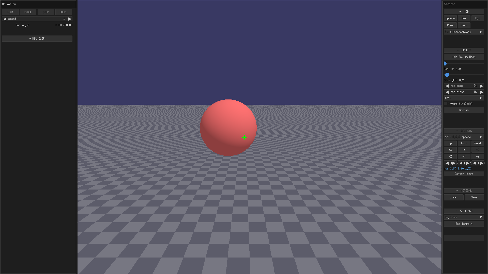
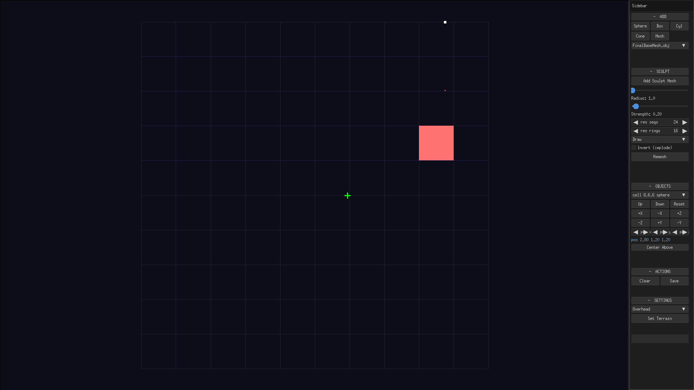
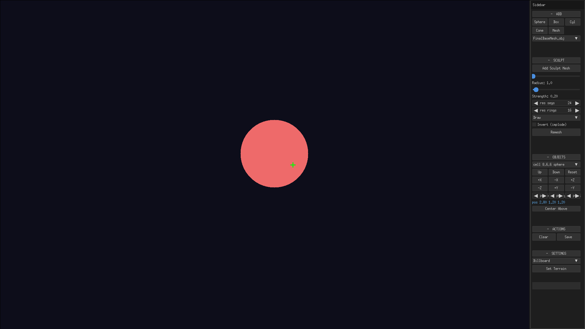
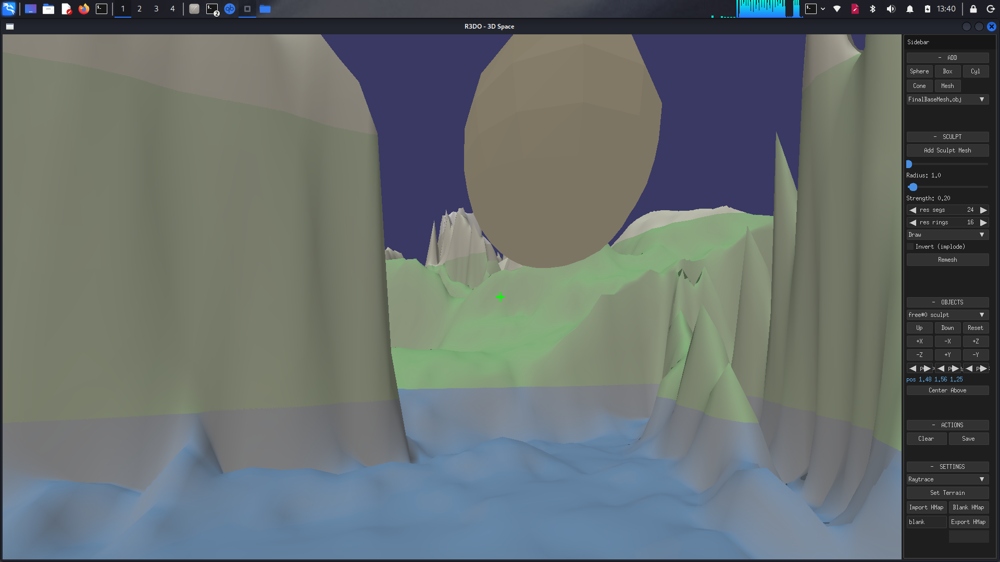

# R3DO — RENDRING 3-2-1D OBJECTS 
ai assisted engine 
A real-time CPU ray tracer rendered into an X11 window. Build scenes in a 10×10×10
voxel grid (spheres, boxes, cylinders, cones, meshes, sculptable terrain), animate
them with keyframes or procedural modifiers, and drag objects directly in the viewport.



## Features

- **Ray traced scene view** — DDA voxel traversal keeps ray casts fast; directional
  diffuse lighting with gamma-corrected output.
- **Mouse drag gizmo** — press left-click on any object to grab it: it follows the
  mouse on the camera-facing plane, cell objects magnetize to the nearest free cell,
  and objects dragged outside the grid automatically become free objects (and
  re-home when dragged back). Empty-space drags still rotate the camera.
- **Shared position** — drag, move buttons and the sidebar `pos x/y/z` editor all
  move the same live base. The animation system reads that base every frame, so any
  edit changes where an animation plays from without breaking your keys.
- **Animation system** — keyframe clips per target with Position / Rotation / Scale /
  Color tracks, linear and eased interpolation, per-clip looping, a scrub timeline,
  and procedural modifiers (**Sine Bob**, **Spin**, **Noise Shake**) you can stack on
  top of keys. Targets can be free objects, grid cells, or the **camera** itself.



- **Animation panel** — press `T` to open. Play / pause / stop / loop, playback
  speed, timeline scrub (previews the pose while paused), key capture straight from
  the live scene, per-track listing, and the target picker with a camera entry and
  cell-target mode.



- **Render modes** (cycle with `B` or the sidebar combo) are a data-driven
  registry in `modes/` (`MODES[]` in `modes.cpp`); add a mode by appending one
  table entry and writing one render function — the sidebar, cycling and save
  indices follow automatically. Built-in modes:
  - **Raytrace** — full path through the grid; all animation properties apply.
  - **Billboard** — fast 2D sprite projection (circle / diamond / triangle per shape).
  - **Overhead** — top-down map of the grid with free-object markers.
  - **Static** — camera-relative sprite projection with zero interaction.
  - **Sculpt** — brush-based mesh sculpting (Draw / Inflate / Smooth-style
    brushes, invert, radius & strength sliders, remesh, terrain load), with its
    own undo stack. Subsequent modes in the list are non-sculpt editors.




- **Skeletons** — attach a 3-bone chain (root / spine / tip) to any selected
  mesh or sculpt object via the sidebar **BONES → Add Skeleton**; vertices bind
  to the nearest joint. Animation clips can then key individual bones
  (rotation about the bind joint, position = joint offset) so one object can
  bend and wave without separate parts. The BONES section also edits chains:
  `+ Bone` hangs a new bone under the selected one, `- Bone` deletes leaf bones
  (their verts re-bind to the parent), `Set Name` renames, and `Re-link verts`
  re-binds every vertex to the current joints. Bones follow drags: bind
  vertices and stored joint offsets translate with the object.

- **Sculpt + skeleton interplay** — the bind snapshot refreshes after every
  brush stroke, undo and redo, so geometry sculpted after Add Skeleton is
  kept when a pose is applied instead of snapping back to the bind-time
  shape; when the chain is at rest the verts also re-pick joints, so a bulge
  crossing a bone boundary re-attaches to the closer joint automatically.
  Sculpting while a pose is active keeps the edit in bind space (assignments
  unchanged), so posing stays live during strokes. Any pose change (sliders,
  pose drags, clip playback) re-applies the skeleton and re-renders every
  affected view, including idle Raytrace/Sculpt frames.

- **Bone gizmo (Bones mode)** — in the Bones render mode, press on a joint dot
  to grab that bone (the sidebar follows the pick); drag moves the joint and
  everything hanging under it. If the chain is at rest, the drag edits the
  bind-space offset and the verts re-bind on release; if a pose is active the
  drag bends the live preview instead (pose translation, nothing re-binds).
  The verts/corners bound to the selected bone are tinted orange so rig
  regions are visible.

- **Weighted skinning** — binds carry two joints per vertex/corner: the two
  nearest bind-space joints blended by inverse distance, so folds deform with
  one smooth seam instead of a hard crease between bone regions.

- **Pose mode** — the BONES section has roll/yaw/pitch sliders (degrees,
  euler `Rz*Ry*Rx`: roll = screen-plane spin, yaw = turn, pitch = nod) on the
  selected bone, applied live; `Straighten` snaps the chain back to rest.
  Sliders and clip animation both write live poses; straighten clears them.

- **Scope note** — each object owns at most one skeleton and bones only skin
  their own object's geometry; cross-object parenting (a limb object hanging
  off another object's bone) is not supported.

- **Bones render modes** — cycle with `B`:
  - **Bones** — renders the scene like Billboard and overlays every skeleton
    (joints as dots, links as lines, joint names tagged). Fast; the original
    bones editor view.
  - **Bones RT** — full raytraced frame with the same skeleton overlay drawn
    on top, so the rig is visible (and its joints grabbable with the gizmo)
    in the real render. Both modes also tint the verts bound to the selected
    bone; gizmo/selection still work, so chains can be inspected while
    editing in raytrace.


- **Heightmap terrain** — drop grayscale PNGs into `maps/`, then **Import HMap**
  in the sidebar (the modal lists every PNG; pixel luminance becomes height on a
  0-3 world-unit ramp sized to the grid). The terrain renders in **Overhead**
  (height-colored map) and **Raytrace** mode — Billboard does not draw terrain.
  Press `B` to cycle to Overhead after importing. **Blank HMap** starts a flat
  field for painting: in **Overhead** mode, left-drag raises ground (Shift
  lowers) using the sculpt radius/strength sliders. **Export HMap** writes the
  painted field back as a PNG (name defaults to `blank`, saved in `maps/`) so
  it round-trips through saves — imported maps already persist via their
  source path.

## Terrain and world generation

Combine imported heightmaps with the sculpt system to build whole worlds:
height-colored ground (water / grass / rock / snow bands), camera that rides
the ground, and any sculpt mesh or primitives placed on top — all rendered by
the raytrace engine with the shared directional lighting.



## Controls

| Key | Action |
|-----|--------|
| W/S | Move forward/backward |
| A/D | Strafe left/right |
| Q/E | Move up/down |
| ← → ↑ ↓ | Look around |
| B | Cycle render mode (Raytrace → Billboard → Overhead → Sculpt → Static) |
| T | Toggle the animation panel |
| G | Toggle ground mode |
| Space | Full-quality re-render |
| Ctrl+Z / Ctrl+Y | Undo / redo scene (sculpt mode has its own) |
| Esc | Quit — while dragging an object: cancel the drag |
| F11 | Toggle windowed mode |
| **Left click on object** | Grab and drag it (gizmo) |
| **Shift + drag** | Vertical-only movement |
| **Left drag on empty space** | Look around (mouse look) |
| **Left click empty space** | Delete the object under the center crosshair |
| **Right click** | Quick-place the last used shape |
| **Right drag (sculpt mode)** | Sculpt stroke (inverts the brush) |
| Alt+Shift | Toggle mouse capture |

The program starts at the resolution saved in `settings.cfg` (or 1920×1080 by
default). Use the **Settings** button on the start screen to change it.

## Start Screen

On launch you get **New Scene**, **Load Scene**, **Sculpt** (jumps straight into
sculpt mode) and **Settings**. **Load Scene** lists all `.r3do` files found in
`saves/`; the default autosave is not loaded automatically.

## Save System

All scene changes are automatically saved to `saves/default.r3do`. To snapshot a
scene, click **Save** name the file; loads are picked from the start screen.
Scene files store objects, transforms, and animation clips. Sculpt meshes save
as exact vertex/face blobs under `meshes-<save>/`; imported `.obj` meshes save
by source path. A heightfield terrain with no source path (blank or paint-only
canvas) is auto-exported to `maps/auto_<save>.png` on the first save.

Bone chains (`bones`/`bone` lines) attach per free object; animation clips can
target single bones (`anim` lines carry a bone index).

## Animation Workflow

1. Press `T`, then `+ NEW CLIP`.
2. Pick a target in the combo: a free object, one of its bones (after
   `Add Skeleton` in the BONES section), `cell i,j,k` (enable the cell
   checkbox), or `camera`.
3. Set the key time with the slider, adjust key x/y/z (or press **SYNC FROM TGT**
   / **KEY @ TGT** to capture the target's live pose), then `+ KEY`.
4. `PLAY` to watch; pause and scrub the timeline to preview any time.
5. Stack procedural modifiers (`+ SINE / + SPIN / + SHAKE`) for continuous motion.

Because keys are stored as offsets from the object's *live* base position, you can
keep moving the object with the drag gizmo or the position editor at any time — the
whole animation travels with it. The world position is shown in both the sidebar
(`pos` fields) and the animation panel (`world pos:` readout).

## Build

Requires libx11-dev.

```sh
make -j4
./R3DO
```

## How it works

- **DDA traversal** (`grid.hpp`): rays step cell-by-cell along the voxel grid using
  a 3D Digital Differential Analyzer with 4×4×4 chunk skip flags; free objects are
  always tested first so off-grid placement still renders.
- **Primitives**: spheres, axis-aligned boxes, capped cylinders/cones, triangle
  meshes with a SAH BVH, and sculptable meshes (flat BVH kept in sync on moves).
- **Animation** (`animation.hpp/cpp`): clips hold typed tracks with per-key
  interpolation; `ClipInstance` binds a clip to a free object, cell or camera and
  stacks procedural modifiers; playback speed and loop semantics are per clip.
- **Transforms** (`hittable.hpp`): per-object animated offset + Euler rotation +
  scale + color tint applied in every shape's `hit()` with an identity fast path.
- **UI**: Nuklear drawn into the same X11 framebuffer (`ui/` — core event hook,
  sidebar, animation panel, start screens).
- **Multi-sampling**: low quality (1 sample/px) during movement; full quality
  (4 samples/px) on Space per `settings.cfg`.

## UI compositing

The scene and both Nuklear panels share one X11 window. An earlier build let
render modes clear or push the window directly while `present()` blitted the
panels before the framebuffer update. Any full-window fill or late `XPutImage`
then erased the sidebar and animation panel, producing a one-frame blink every
frame in every render mode.

Compositing is now owned by `present()` in `src/main.cpp`: render to the
framebuffer only, `display.update()` with panel skip rects, `nkui.render()` to
blit panels last, then overlay crosshairs/gizmos guarded by `nkui.hit()`.
Full-screen previews use `DisplayWin::clear_framebuffer()` instead of
`fill_rect()`; duplicate `display.update()` calls were removed from
`src/render.cpp` and the Billboard/Overhead/Static modes; degenerate panel rects
are dropped in `ui/nkui_core.cpp`, and the Nuklear blit is flushed. Verified in
the last build with `make -j2` and an editor smoke test: panels no longer flash.

## Files

Sources live in six folders (`src/`, `anim/`, `shapes/`, `modes/`, `sculpt/`,
`ui/`); the Makefile passes one `-I` per folder so includes stay bare
(`"grid.hpp"`) and files can move without touching include lines.

| File | Role |
|------|------|
| `src/main.cpp` | Entry point, game loop, drag gizmo wiring, animator application |
| `anim/animation.hpp` / `.cpp` | Clips, keyframes, interpolation, modifiers |
| `ui/nkui.hpp` / `nkui_core.cpp` | Nuklear setup, event hook, frame compositing |
| `ui/nkui_sidebar.cpp` | Sidebar (add, sculpt, objects, actions, settings) |
| `ui/nkui_anim.cpp` | Animation panel (playback, keys, targets, modifiers) |
| `ui/startscreen.cpp` | Start / load / settings screens |
| `ui/ui.hpp` / `ui/ui.cpp` | Scene state, move/select, drag gizmo, save dialog |
| `ui/sculpt_ui.cpp` | Sculpt-mode overlay panel |
| `src/render.hpp` / `.cpp` | Shared raytrace engine, picking (`pick_at_mouse`) |
| `src/render_modes` → `modes/render_modes.hpp` + `modes.cpp` | Display-mode registry (`MODES[]`); order is the save-format index: 0 Raytrace, 1 Billboard, 2 Overhead, 3 Sculpt, 4 Static |
| `modes/billboard.cpp` `modes/overhead.cpp` `modes/static.cpp` | 2D editor previews; each mode is one render function plus a `uses_mouse_for_strokes` flag |
| `src/grid.hpp` | Voxel grid with DDA traversal, cell management, terrain |
| `src/hittable.hpp` | Hittable base incl. animated transforms |
| `shapes/sphere.hpp` `box.hpp` `cylinder.hpp` `cone.hpp` | Primitives |
| `shapes/mesh.cpp` / `mesh.hpp` | OBJ meshes with SAH BVH; `shapes/obj_loader.*` OBJ parsing |
| `shapes/heightfield.cpp` / `.hpp` | PNG-heightmap terrain: ray-marched Hittable, paint brush, PNG import/export |
| `vendor/stb/` | Vendored single-header PNG codecs (`stb_image`, `stb_image_write`) |
| `maps/` | Heightmap PNGs for the terrain importer (created on demand) |
| `sculpt/sculpt_mesh.cpp` / `sculpt_engine.cpp` | Sculptable meshes and brush engine (`sculpt/brush.hpp`) |
| `src/saver.hpp` / `.cpp` | Scene save/load `.r3do` |
| `src/display.hpp` / `.cpp` | X11 window, input, MIT-SHM framebuffer |
| `src/settings.hpp` / `.cpp` | Resolution settings persistence |

## Known limitations

- Billboard and Overhead previews show position animation only — rotation, scale
  and color tint apply in Raytrace mode.
- Cell-bound objects animate within the grid hull; poses pushed outside the grid
  hull are invisible in raytrace mode (free objects have no such limit).
